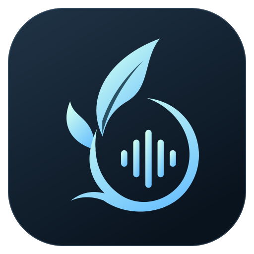

<p align="center">
  
</p>

<h1 align="center">EdenVoice</h1>
<p align="center"><strong>English</strong> · <a href="README.zh-CN.md">简体中文</a></p>
<p align="center">Let voice bring us closer.</p>
<p align="center">Self-hosted voice chat for friends. Play together, watch a movie, or simply spend time in the same room.</p>
<p align="center">
  <a href="#getting-started">Getting started</a> ·
  <a href="#host-your-own-server">Host your own server</a> ·
  <a href="#local-development">Local development</a> ·
  <a href="#documentation">Documentation</a>
</p>

EdenVoice puts voice conversations first: connect to your own server, join a room, and start talking. Each room is also a small shared space, with friends seated together, chat bubbles, game activity, and memories of the time you spend together.

The project includes a **Go server, a Rust audio and networking core, a Tauri 2 + React desktop client, and a web administration console**. The server runs as a single binary with the admin console built in; no separate database or Node.js installation is required. The current source version is **v0.8.5**. Prebuilt packages may follow a different release schedule; check the release notes for the version you download.

## Why EdenVoice?

- **A place of your own for your friends.** You control the server, rooms, permissions, and data. Friends join with a nickname and server address, without registering a central platform account.
- **Built around everyday conversation.** Voice activity detection, push-to-talk, noise suppression, remembered individual volume levels, and device testing help you hear each other clearly and talk naturally.
- **Shared activities that stay lightweight.** Synchronized local movies, screen sharing you choose to watch, and a small timer fit around the room you are already in.
- **Memories of time spent together.** Eden Archive records shared games, movies, and room moments, with recap cards featuring participant avatars and nicknames.
- **Yours to change, from the interface to the server.** Build, deploy, and distribute your own version. Third-party dependencies retain their respective licenses; see the licensing information below.

## Features

| Experience | What it includes |
| --- | --- |
| Voice chat | Opus encoding, a separate jitter buffer for each speaker, and FEC / PLC packet-loss recovery. Supports P2P, SFU, and relay paths selected according to network conditions, with automatic room audio quality or Q1–Q10 presets. |
| Audio settings | RNNoise, DSP, and other processing modes; voice activity detection and push-to-talk; input/output device selection; raw and processed microphone monitoring. Volume up to 300%, with remembered volume levels for individual members. |
| Friends' rooms | Dark and light themes, avatar seating, short-lived chat bubbles, and selectable text chat. Compact presentation for larger groups, with room and chat views. |
| Game activity | Detects configured games on Windows and shows them in the member list. When more than half the room, with at least two members, are playing the same game, the room switches to a game scene after the activity remains stable. Administrators can publish game detection catalog updates. |
| Watch together | Each participant uses their own local movie and mpv player. Synchronizes play, pause, and playback position, with progress recovery. The host and authorized administrators control shared playback; other members can resynchronize their own player. |
| Screen sharing | Watch in a room tab or full screen, with configurable resolution, frame rate, and bitrate. One sharer per room; members choose to start watching, and rooms remain isolated. Must be enabled on the server. |
| Focus timer | A compact stopwatch / countdown widget with custom titles and up to 10 saved timers, navigated using dots. One timer runs at a time; countdown completion sounds only on the local client. |
| Eden Archive | Game-specific cards, participant avatar groups, game and text filters, a timeline, and evening recaps. Hide nicknames, room names, or activity names before exporting. |
| Administration and everyday use | Server and room passwords, invitation links, saved servers, role-based permissions, bans, announcements, signed updates published separately for each platform, and local voice diagnostics. |

Voice quality depends on microphones, system load, packet loss, and server bandwidth. The project includes testing and diagnostic tools, but does not promise a fixed user capacity or interruption-free audio on every network.

## Getting started

### Install the client

Check [Releases](https://github.com/SmileSion/EdenVoicePublic/releases) for published versions and attached packages. Choose a package matching your operating system and CPU architecture. If no prebuilt package is available, follow [Local development](#local-development) to build it yourself.

| Platform | Installation |
| --- | --- |
| Windows x64 | Run `EdenVoice_<version>_x64-setup.exe`. WebView2 is required; the installer can guide you through installing it. |
| macOS | Open the `.dmg` and drag the app to Applications. Check the release filename for its CPU architecture. |
| Linux x64 | Make the `.AppImage` executable, then run it. Your desktop environment needs the corresponding WebKitGTK and audio runtime dependencies. |

### Your first conversation

1. Get the address, such as `voice.example.com:9000`, and server password, if one is set, from the administrator. If you do not have a server yet, follow the hosting instructions below.
2. Open the client and enter the address, nickname, and password. The first connection displays the server's identity fingerprint; confirm it with the administrator before trusting it.
3. After connecting, you enter the lobby. **The lobby shows online presence; voice chat starts only after you join a voice room.** Double-click a room in the left sidebar to join. Password-protected rooms prompt for a password.
4. Select your microphone and headphones in Settings, and use the local audio test to check them. With voice activity detection, simply start speaking. For push-to-talk, configure a shortcut first.
5. Use a member's individual volume control to adjust how loudly you hear them; your choice is remembered. You can copy an invitation link from the server menu and share it with friends, who confirm before joining.

Server passwords, room passwords, and web admin passwords are separate credentials. Saving a server does not write its password to disk. The password stays in memory during the current connection so the client can reconnect after a disconnect.

### Play, watch, and remember

- **Game activity:** Sharing is enabled by default for new configurations. Windows users can disable it under Settings → Profile → Game activity. Only matched game identifiers are reported, not your full process list. macOS and Linux users can view friends' activity, but do not run Windows game detection.
- **Watch together:** Everyone needs mpv, a configured player path, and their own copy of the same movie version. Join the same voice room, start or join a watch session, and select your local movie. Once everyone is ready, the host or an administrator starts playback. Movies are neither uploaded to the server nor automatically distributed to other members.
- **Screen sharing:** In a supported room, select a screen or window and confirm sharing. Other members choose to watch in the current window or full screen. Stopping playback of a shared screen does not disconnect voice chat.
- **Eden Archive:** Open the room archive to explore shared games and gatherings, then choose a card to create a recap image. Records accumulate once collection is enabled on the server; past activities are not reconstructed.

## Host your own server

### 1. Prepare the binary and configuration

Use `voice-server` from a release package, or build from source with Go 1.26.10 and the corresponding toolchain available:

```bash
git clone https://github.com/SmileSion/EdenVoicePublic.git
cd EdenVoice/server
go build -trimpath -o voice-server ./cmd/voice-server
cp config.example.toml config.toml
```

Edit the existing fields in `config.toml`. At a minimum, check the following:

```toml
# Top-level fields: keep these before any [section]
server_name = "Our gathering place"
server_password = "replace-with-your-own-password"
control_addr = "0.0.0.0:9000"
voice_addr = "0.0.0.0:9001"

[security]
data_dir = "data"
allow_legacy_insecure = false
```

**The example configuration and a server started without a configuration file both default to the server password `SmileSion`. Change it before exposing the server to the internet.** Set `server_password = ""` to allow connections without a password, and restart after changing it. The snippet above contains selected fields only; edit the full example rather than adding a duplicate `[security]` section.

Start the server:

```bash
./voice-server --config config.toml
```

Lobby, Gaming, and AFK rooms are created by default. Clients connect to the **TCP control port**, for example `voice.example.com:9000`. Point your domain's DNS record at your server; IPv4 and IPv6 addresses are also accepted.

### 2. Open the required ports and preserve data

| Port | Purpose | Public access needed? |
| --- | --- | --- |
| TCP `9000` | Connection, authentication, rooms, and chat control | Yes |
| UDP `9001` | Voice registration and SFU / relay media | Yes |
| TCP `9100` | `/healthz` and Prometheus `/metrics` | Loopback by default; keep access private |
| TCP `9101` | Web admin console | Disabled by default; an SSH tunnel is recommended |
| UDP `7010` | Screen-sharing WebRTC traffic | Only when screen sharing is enabled |

Check your cloud security group, operating system firewall, and NAT forwarding as needed. These are example defaults; your TOML configuration is authoritative. Screen sharing is disabled by default. To enable it, configure `[screen_share]` with `enabled = true`, the appropriate `public_ip`, and `udp_port = 7010`. All screen-sharing connections use this fixed UDP port, separate from the voice port. Restart after changing the public address or port; see the [screen-sharing guide](docs/screen-sharing.md).

Upgrading to v0.8.5 does not require a client update for the port change: clients that already support screen sharing discover the server port through WebRTC negotiation. Clients without that feature can continue voice chat. When reading an older configuration without `udp_port`, the server uses its `udp_port_min` as the single port; migrate to the explicit `udp_port` field and remove both range fields. After restarting and verifying sharing, remove firewall rules for unused ports from the old range. Administration settings for picture quality and viewing capacity continue to apply.

`security.data_dir` stores the server identity, members and permissions, rooms, chat, archives, and administration settings. **Back up and preserve the entire directory when updating the binary.** Deleting the identity files will cause clients to detect a changed server identity. Text chat is appended to per-room JSONL files. The client currently displays the latest 100 messages; older records remain on disk.

On first startup with a new data directory, the console prints a one-time **MASTER Token**. Connect with the client, then choose the option to enter a Master Token in the server menu to claim server ownership. This is neither the password for joining the server nor the web login password. Restarting before ownership is claimed rotates the automatically generated token.

### 3. Optional: enable the web admin console

Claim MASTER ownership first, then stop the server. Initialize an account using the same binary, configuration, and data directory:

```bash
# Run in Bash on the server; the password stays out of command-line arguments
read -r -s -p 'Web admin password: ' web_admin_password
printf '\n'
printf '%s' "$web_admin_password" | ./voice-server --config config.toml --web-admin-init admin
unset web_admin_password
```

Passwords must be 12–72 bytes long. If no identity is specified, the account is bound to the current MASTER. Edit the existing admin configuration in TOML:

```toml
[web_admin]
enabled = true
listen_addr = "127.0.0.1:9101"
```

Restart the server and create a tunnel from your own computer. Replace `your-user` with your SSH username:

```bash
ssh -N -L 9101:127.0.0.1:9101 your-user@voice.example.com
```

Open `http://127.0.0.1:9101` in your browser and sign in with the account you just created. The console shows resources, traffic, and connected client versions, and manages rooms, members, bans, game detection, announcements, and client updates. See the [web admin guide](docs/web-admin.md) for administrator and read-only permissions, and HTTPS reverse proxy setup.

### Docker

Run these commands from the repository root. Edit the server password before starting the container:

```bash
cp server/config.example.toml server/config.toml
mkdir -p server/data
# Edit server/config.toml here

docker build -f server/Dockerfile -t edenvoice-server .
docker run -d --name edenvoice --restart unless-stopped \
  --user "$(id -u):$(id -g)" \
  -w /srv \
  -p 9000:9000/tcp -p 9001:9001/udp \
  -v "$(pwd)/server/config.toml:/etc/edenvoice/config.toml:ro" \
  -v "$(pwd)/server/data:/srv/data" \
  edenvoice-server --config /etc/edenvoice/config.toml
```

This example uses the default relative data path, `data`, persisted to `server/data` on the host. Run `docker logs edenvoice` to find the first MASTER Token. For screen sharing, enable it in TOML and add `-p 7010:7010/udp` with matching port numbers. A loopback listener inside a container is not directly exposed to the host; web administration requires its own appropriate proxy and listener configuration.

### systemd

The repository includes [`edenvoice.service`](server/deploy/edenvoice.service). It runs as a dedicated `edenvoice` user, with the binary at `/opt/edenvoice/voice-server`, the configuration at `/etc/edenvoice/config.toml`, and `/var/lib/edenvoice` as its working directory.

Create the user and directories before installation, and give that user write access to the data directory. Set `security.data_dir` to `/var/lib/edenvoice` and `archive.rules_file` to `/var/lib/edenvoice/eden-archive-rules.json`. Copy the unit to `/etc/systemd/system/`, then run:

```bash
sudo systemctl daemon-reload
sudo systemctl enable --now edenvoice
sudo journalctl -u edenvoice -f
```

A separate example uses ports `7000/7001`. Choose ports and password requirements for your own deployment; do not mix it with the default example unchanged.

## Data and security boundaries

Control connections use TLS 1.3 with a pinned, trusted server identity. Voice traffic uses authenticated encryption. **The SFU decrypts media on the server and re-encrypts it for recipients, so it is not end-to-end encryption that hides audio from the server operator.** Connect only to servers you trust, and back up your client and server identities.

The server stores chat, member profiles, and Archive activity when enabled. Game activity is a social status, not proof of being on the same team or of match results. Lightweight voice diagnostics record only local statistics: no audio recording, chat content, or automatic uploads. Users can export them manually. See [security and permissions](docs/v0.5-security-administration.md), [chat persistence](docs/chat-history.md), and [voice diagnostics](docs/voice-diagnostics-evening-recaps.md).

## Local development

### Requirements

- Node.js 22 and npm; the project uses `package-lock.json`.
- Rust 1.95.0, the current release toolchain, and a system C/C++ build environment.
- CMake, Meson, Ninja, pkg-config, and libclang; the client builds native Opus and WebRTC audio dependencies.
- Go 1.26.10 for the server. Docker can be used for Linux packaging.

On macOS, install Xcode Command Line Tools, then the build dependencies:

```bash
brew install cmake meson ninja pkg-config
```

Windows requires the Visual Studio C++ toolchain, Windows SDK, LLVM/libclang, and WebView2. Linux requires development packages for ALSA, udev, WebKitGTK 4.1, AppIndicator, and related libraries; see the [Linux build image](scripts/linux-release.Dockerfile) for the full list. The project does not use GitHub Actions; checks and releases run through local scripts.

### Run locally

```bash
# Terminal 1: after preparing the configuration in server/
cd server
go run ./cmd/voice-server --config config.toml
```

```bash
# Terminal 2: start the desktop client from the repository root
cd desktop
npm ci
npm run tauri dev
```

Connect to `127.0.0.1:9000` using your configured server password. To preview only the interface, run `npm run dev`. This uses simulated data in the browser; it does not connect to a real server or validate native audio capture.

Repository layout:

```text
desktop/       Tauri desktop host, React interface, and platform features
client/        Rust audio, networking, and identity core; retained Slint reference UI
server/        Go control service, voice forwarding, screen sharing, and web admin
product-site/  Product website and download manifest
scripts/       Build, release, and validation tools
docs/          Feature guides, protocols, architecture, and historical test notes
```

### Checks and packaging

Run from the repository root:

```bash
(cd server && go test ./... && go vet ./...)
cargo test --manifest-path client/Cargo.toml --lib
CMAKE_POLICY_VERSION_MINIMUM=3.5 cargo test --manifest-path desktop/src-tauri/Cargo.toml --lib
npm --prefix desktop run build
npm --prefix desktop run test:install
npm --prefix desktop test
npm --prefix desktop run test:admin
cargo test --manifest-path client/Cargo.toml --test nnef_security
python3 scripts/generate-third-party-licenses.py --check
```

Tests cover protocols, permissions, audio buffering and recovery, watch-party and screen-sharing lifecycles, and more. Browser simulations, target compilation, and synthetic media tests on one machine do not replace testing on real devices across platforms. Screen sharing still needs real-device validation for the Windows native picker and cross-device scenarios. Capturing system audio on macOS requires 14.2 or later. On Windows, shared system audio may include voice-chat playback, so it is off by default.

```bash
# Client for the current platform; reads the version from desktop/package.json
./scripts/package-release.sh

# Linux amd64 / arm64 servers
./scripts/package-server-release.sh

# Build multiple platform packages on macOS; the Linux client requires Docker
./scripts/package-all-release.sh
```

Packages and a checksum manifest are written to `dist/v<version>/`. Overwriting packages for the same version requires `--force`. Cross-packaging Windows on macOS also requires tools such as LLVM, LLD, NSIS, and cargo-xwin. Run each script with `--help` for its options.

Client updates are published per platform by the administrator of the connected server. Downloads require user confirmation, with installation available immediately or on the next launch. **Distributing your own automatic updates requires your own private signing key and the corresponding public key configured in the client.** The repository includes only verification public keys, never release private keys. Do not commit private keys, cloud credentials, or real deployment configurations to Git. See the [signed update guide](docs/automatic-updates-2026-09-08.md).

## Documentation

Most detailed guides below are currently written in Chinese. This README covers the main installation, hosting, and development steps in English.

| Topic | Guide |
| --- | --- |
| v0.8.5 changes and upgrade compatibility | [Release notes](docs/release-v0.8.5.md) |
| Server passwords, invitations, and compatibility | [Server access](docs/server-access-and-invitations.md) |
| Admin deployment, accounts, and permissions | [Web administration](docs/web-admin.md) |
| Noise suppression and audio processing | [Audio processing](docs/audio-processing.md) |
| Routing, unreliable networks, and recovery | [Network architecture](docs/v0.4-network-resilience.md) · [Recovery behavior](docs/voice-network-recovery.md) |
| Watch parties and progress recovery | [Usage and permissions](docs/watch-party-moderation-2026-09-07.md) · [Progress recovery](docs/watch-resume-and-archive-recap.md) |
| Screen-sharing configuration and testing limits | [Screen sharing](docs/screen-sharing.md) |
| Game activity and dynamic detection catalogs | [Game activity](docs/windows-game-presence.md) |
| Archives, shared games, and custom rules | [Playing together](docs/archive-shared-games.md) · [Evening recaps](docs/voice-diagnostics-evening-recaps.md) · [Archive rules](docs/eden-archive-rules.md) |
| How the project works | [Architecture](docs/architecture.md) · [Control and media protocols](docs/protocol.md) |
| Licensing, redistribution, and update signing | [Open-source guide](docs/open-source.md) |

Dated documents preserve the implementation and testing context of their time. Where versions differ, follow the current source and the release notes for your version.

## Contributing

Feedback, bug reports through [Issues](https://github.com/SmileSion/EdenVoicePublic/issues), and pull requests are welcome. For audio issues, include client and server versions, operating system, room size, network mode, reproduction steps, and sanitized diagnostics. Do not upload passwords, private identity keys, or recordings of other people.

Development prioritizes reliable conversations, clear interactions, and small features friends will actually use. For larger changes, start an issue to discuss the approach, then submit a focused implementation with validation notes.

Report security vulnerabilities privately as described in [SECURITY.md](SECURITY.md). Do not post active credentials or exploitable deployment details in public issues.

## License

The project is licensed under **GNU GPL v3.0 (GPL-3.0-only)**; see [LICENSE](LICENSE). You may use, modify, and redistribute it, including commercially. When distributing modified versions, follow the GPL's source code and licensing requirements. Third-party code, models, and icons retain their original licenses; see [THIRD_PARTY_NOTICES.md](THIRD_PARTY_NOTICES.md) for sources and notices.

Historical versions previously released under MIT retain their original license rights. See [open source and redistribution](docs/open-source.md) for more details.

## Sponsor

If EdenVoice makes it easier for you and your friends to spend time together, you can support continued development and maintenance with a voluntary donation. Using the app, reporting issues, and contributing are also valuable ways to support the project.

Sponsorship details are coming soon. A donation QR code will be added here.

<!--
To add the QR code: save the image as docs/assets/sponsor-qr.png, remove the “Sponsorship details are coming soon” text above, and uncomment the image below.
<p align="center">
  
</p>
-->
