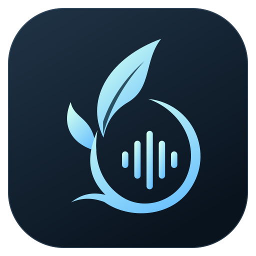

<p align="center">
  
</p>

<h1 align="center">EdenVoice</h1>
<p align="center">
  <a href="README.md">English</a> · <strong>简体中文</strong>
</p>

<p align="center">让声音，更靠近。</p>
<p align="center">为朋友相聚而做的自托管语音软件。一起开黑、一起看片，或者什么也不做，待在同一个房间。</p>
<p align="center">
  <a href="#开始使用">开始使用</a> ·
  <a href="#自建服务器">自建服务器</a> ·
  <a href="#本地开发">本地开发</a> ·
  <a href="#文档">文档</a>
</p>

EdenVoice 把语音通话放在最前面：你和朋友连接自己的服务器，加入房间就能交谈。房间同时也是一个小小的共同空间——头像围坐、聊天气泡、正在玩的游戏，以及属于大家的相聚回忆。

项目包含 **Go 服务端、Rust 音频与网络核心、Tauri 2 + React 桌面客户端、Web 管理后台**。服务端以单个二进制运行，管理后台内置，无需另装数据库或 Node.js。当前源码版本为 **v0.8.5**；安装包与源码进度可能不同，请以对应发布说明为准。

## 为什么选择 EdenVoice

- **给固定的朋友一个自己的地方。** 服务器、房间、成员权限和数据由你管理；朋友使用昵称和服务器地址即可加入，不需要注册统一平台账号。
- **围绕日常通话设计。** 语音活动检测、按键说话、降噪、个人音量记忆和设备测试，服务于“能听清、聊得自然”这件事。
- **一起做点事，但保持轻量。** 同步本地影片、按需观看屏幕共享、一个小计时器，都围绕当前房间展开。
- **留下相聚的痕迹。** Eden Archive 记录共同游戏、观影和房间时刻，可以生成带头像、昵称的回顾卡片。
- **从界面到服务端都可以修改。** 可自行构建、部署和分发；第三方依赖保留各自的许可，见文末说明。

## 已有功能

| 场景 | 能做什么 |
| --- | --- |
| 语音通话 | Opus 编码、每位说话者独立抖动缓冲、FEC / PLC 丢包恢复；支持 P2P、SFU 和中继，按网络情况选择链路；房间可配置自动音质或 Q1–Q10。 |
| 音频设置 | RNNoise、DSP 等处理模式，语音活动检测 / 按键说话，输入输出设备切换、原声与处理后自听；音量最高 300%，记忆每位成员的个人音量。 |
| 朋友的房间 | 深色 / 浅色外观、头像座位、短时聊天气泡、可复制的文字聊天；人数较多时收纳展示，房间与聊天视图可切换。 |
| 游戏状态 | Windows 识别已配置的游戏，在成员列表展示；同一房间超过半数且至少两人在玩同一款游戏时，经过稳定观察自动进入游戏场景。管理员可动态发布识别目录。 |
| 共同观影 | 每人使用本地 mpv 和自己的影片，同步播放、暂停与进度，支持恢复观影进度；主持人及有权限的管理员控制全员播放，其他成员可同步自己。 |
| 屏幕共享 | 在房间内的屏幕标签页观看，可调整分辨率、帧率、码率并全屏；每房间一位分享者，成员主动加入观看，不同房间独立。需服务端启用。 |
| 专注计时 | 紧凑的正向计时 / 倒计时组件，自定义标题，最多保存 10 个计时，通过小圆点切换；同时运行一个，倒计时结束仅在本机提示。 |
| Eden Archive | 游戏专属卡片、成员头像组合、按游戏和文字筛选、时间线及“这一晚”回顾；导出前可隐藏昵称、房间或活动名称。 |
| 管理与日常使用 | 服务器密码、房间密码、邀请链接、收藏服务器、分级管理权限、封禁、公告、平台分别发布的签名更新，以及本地语音问题诊断。 |

语音的实际流畅度仍取决于麦克风、系统负载、网络丢包和服务器带宽。项目提供测试与诊断工具，但不承诺固定人数上限或任何网络下都无卡顿。

## 开始使用

### 安装客户端

在 [Releases](https://github.com/SmileSion/EdenVoicePublic/releases) 查看已发布版本及附件。请选择与操作系统、CPU 架构匹配的包；没有对应预编译包时，可按[本地开发](#本地开发)自行构建。

| 平台 | 安装方式 |
| --- | --- |
| Windows x64 | 运行 `EdenVoice_版本号_x64-setup.exe`；依赖 WebView2，安装器可引导安装。 |
| macOS | 打开 `.dmg`，将应用拖入“应用程序”；包的 CPU 架构以发布文件为准。 |
| Linux x64 | 为 `.AppImage` 添加可执行权限后运行；桌面环境需具备对应 WebKitGTK / 音频运行依赖。 |

### 第一次和朋友通话

1. 向服务器管理员取得地址，例如 `voice.example.com:9000`，以及服务器密码（如果设置了）。没有服务器时，按下文自建一个。
2. 打开客户端，填写地址、昵称和密码。首次连接会显示服务器身份指纹，请与管理员确认后信任。
3. 连接成功后进入大厅；**大厅只是在线展示，加入语音房间后才开始通话**。双击左侧房间加入，需要密码的房间会弹出输入框。
4. 在设置中选择麦克风和耳机，使用本地音频测试确认设备。语音活动检测可以直接说话；选择按键说话后，先配置快捷键。
5. 需要调整某位朋友的声音时，使用成员的个人音量；调整结果会被记住。服务器菜单可以复制邀请链接，发给朋友后由对方确认加入。

服务器密码、房间密码与 Web 管理密码是不同的凭据。收藏服务器不会把服务器密码写入磁盘；当前连接期间会在内存中保留，以便断线重连。

### 一起玩、一起看、留下回忆

- **游戏状态：** 新配置默认开启分享，Windows 用户可在“设置 → 个人资料 → 游戏状态”关闭。只上报匹配到的游戏标识，不上传完整进程列表；macOS / Linux 可以查看朋友状态，暂不执行 Windows 游戏检测。
- **共同观影：** 每人安装 mpv、配置播放器路径并准备同版本影片。加入同一语音房间后开启或加入观影、选择本地影片，待成员准备好后由主持人或管理员播放。影片不会被上传到服务器，也不会自动分发给其他成员。
- **屏幕共享：** 在支持的房间中选择屏幕或窗口，确认后共享；其他成员点击观看，画面嵌入当前窗口，也可全屏。停止观看不影响语音通话。
- **Eden Archive：** 打开房间档案，查看共同游戏与相聚记录，选择卡片制作回顾图片。记录从服务器实际启用采集后积累，不补造过去的活动。

## 自建服务器

### 1. 准备程序和配置

使用发布包中的 `voice-server`，或从源码编译（需要 Go 1.26.10 及可用的对应工具链）：

```bash
git clone https://github.com/SmileSion/EdenVoicePublic.git
cd EdenVoice/server
go build -trimpath -o voice-server ./cmd/voice-server
cp config.example.toml config.toml
```

编辑 `config.toml` 中已有的字段，至少确认以下内容：

```toml
# 顶层字段，放在任何 [section] 之前
server_name = "我们的相聚之处"
server_password = "请替换成你自己的密码"
control_addr = "0.0.0.0:9000"
voice_addr = "0.0.0.0:9001"

[security]
data_dir = "data"
allow_legacy_insecure = false
```

**示例配置和无配置启动的默认服务器密码为 `SmileSion`，公网部署前请修改。** `server_password = ""` 表示无需密码；修改此项后重启。以上是关键字段节选，请在完整示例中编辑，不要重复添加 `[security]`。

运行：

```bash
./voice-server --config config.toml
```

默认创建 Lobby、Gaming、AFK 三个房间。客户端连接的是 **TCP 控制端口**，例如 `voice.example.com:9000`。域名解析到你的服务器即可，客户端也接受 IPv4 / IPv6 地址。

### 2. 放通端口并保留数据

| 端口 | 用途 | 是否需要公网放通 |
| --- | --- | --- |
| TCP `9000` | 连接、认证、房间和聊天控制 | 是 |
| UDP `9001` | 语音注册、SFU / 中继媒体 | 是 |
| TCP `9100` | `/healthz` 与 Prometheus `/metrics` | 默认仅回环，保留内网访问 |
| TCP `9101` | Web 管理后台 | 默认关闭；建议 SSH 隧道 |
| UDP `7010` | 屏幕共享 WebRTC | 仅启用屏幕共享时需要 |

同时检查云安全组、系统防火墙与 NAT 转发。以上是示例默认值，实际以你的 TOML 为准。屏幕共享默认关闭；启用时在 `[screen_share]` 设置 `enabled = true`、正确的 `public_ip` 和 `udp_port = 7010`。所有共享连接复用这个固定 UDP 端口，与语音端口独立；修改公网地址或端口后需要重启。详见[屏幕共享说明](docs/screen-sharing.md)。

升级到 v0.8.5 后，端口变更不要求同步升级客户端：已支持屏幕共享的客户端通过 WebRTC 协商获取服务端端口；不支持共享的旧客户端仍可正常通话。旧配置未填写 `udp_port` 时，服务端使用原 `udp_port_min` 作为唯一端口；建议改成明确的 `udp_port` 并删除两个范围字段。重启且确认共享可用后，可删除旧范围中未使用端口的防火墙规则。后台画质与观看容量限制继续生效。

`security.data_dir` 保存服务器身份、成员与权限、房间、聊天、档案和管理配置。**更新程序时保留整个目录并先备份**；删除身份文件会导致客户端检测到服务器身份变化。文字聊天追加保存到房间 JSONL，客户端当前显示最近 100 条，磁盘上的更早记录仍保留。

首次以新数据目录启动时，控制台会输出一次性 **MASTER Token**。先用客户端连接服务器，在服务器菜单中选择“输入 Master Token”，完成服务器主认领。它不是加入服务器的密码，也不是 Web 登录密码；未认领前重启会轮换自动生成的 Token。

### 3. 可选：启用 Web 管理后台

先完成 MASTER 认领，然后停止服务，在同一程序、配置和数据目录下初始化账号：

```bash
# 在服务器 Bash 中执行，密码不会出现在命令行参数里
read -r -s -p 'Web admin password: ' web_admin_password
printf '\n'
printf '%s' "$web_admin_password" | ./voice-server --config config.toml --web-admin-init admin
unset web_admin_password
```

密码长度为 12–72 字节；未指定身份时，账号绑定当前 MASTER。编辑 TOML 中已有的管理配置：

```toml
[web_admin]
enabled = true
listen_addr = "127.0.0.1:9101"
```

重新启动服务，在自己电脑上建立隧道；将 `your-user` 替换为你的 SSH 登录用户名：

```bash
ssh -N -L 9101:127.0.0.1:9101 your-user@voice.example.com
```

浏览器打开 `http://127.0.0.1:9101`，使用刚创建的账号登录。后台可查看资源、流量与连接版本，管理房间、成员、封禁、游戏识别、公告及客户端更新。管理员和只读账号的权限边界、HTTPS 反代方式见 [Web 管理控制台](docs/web-admin.md)。

### Docker

在仓库根目录执行；先编辑配置里的服务器密码，再启动容器：

```bash
cp server/config.example.toml server/config.toml
mkdir -p server/data
# 在此编辑 server/config.toml

docker build -f server/Dockerfile -t edenvoice-server .
docker run -d --name edenvoice --restart unless-stopped \
  --user "$(id -u):$(id -g)" \
  -w /srv \
  -p 9000:9000/tcp -p 9001:9001/udp \
  -v "$(pwd)/server/config.toml:/etc/edenvoice/config.toml:ro" \
  -v "$(pwd)/server/data:/srv/data" \
  edenvoice-server --config /etc/edenvoice/config.toml
```

此示例使用默认相对数据路径 `data`，持久化到宿主机 `server/data`。可用 `docker logs edenvoice` 查看首次 MASTER Token。如需屏幕共享，在 TOML 启用并增加 `-p 7010:7010/udp`，保持配置与映射端口一致。容器内的回环监听不会直接暴露到宿主机；管理后台还需单独设计对应的代理与监听。

### systemd

仓库提供 [`edenvoice.service`](server/deploy/edenvoice.service)。它以专用 `edenvoice` 用户运行，程序放在 `/opt/edenvoice/voice-server`，配置放在 `/etc/edenvoice/config.toml`，工作目录为 `/var/lib/edenvoice`。

安装前创建该用户和目录，授予其数据目录写权限；将 `security.data_dir` 设为 `/var/lib/edenvoice`，并将 `archive.rules_file` 设为 `/var/lib/edenvoice/eden-archive-rules.json`。复制单元到 `/etc/systemd/system/` 后：

```bash
sudo systemctl daemon-reload
sudo systemctl enable --now edenvoice
sudo journalctl -u edenvoice -f
```

仓库另有 `7000/7001` 端口示例配置，端口与免密设置需按自己的部署决定，不能与默认示例混用。

## 数据与安全边界

控制连接使用 TLS 1.3，并固定信任的服务器身份；语音使用认证加密。**SFU 会在服务器端解密后为接收者重新加密，因此不要将它视为对服务器运营者不可见的端到端加密。** 只连接你信任的服务器，并备份自己的客户端身份与服务器身份。

服务器保存聊天、成员资料及启用后的 Archive 活动；游戏状态用于社交展示，不代表真实组队或战绩证明。轻量语音诊断只记录本地统计，不录音、不收集聊天正文、不自动上传，可由用户手动导出。详见[安全与权限设计](docs/v0.5-security-administration.md)、[聊天持久化](docs/chat-history.md)和[语音诊断](docs/voice-diagnostics-evening-recaps.md)。

## 本地开发

### 环境

- Node.js 22、npm；项目使用 `package-lock.json`。
- Rust 1.95.0（当前发布工具链）和系统 C/C++ 编译环境。
- CMake、Meson、Ninja、pkg-config、libclang；客户端会编译 Opus 和 WebRTC 音频依赖。
- Go 1.26.10（服务端）；Docker 可用于 Linux 打包。

macOS 可先安装 Xcode Command Line Tools，再安装构建依赖：

```bash
brew install cmake meson ninja pkg-config
```

Windows 需要 Visual Studio C++ 工具链、Windows SDK、LLVM/libclang 与 WebView2。Linux 需要 ALSA、udev、WebKitGTK 4.1、AppIndicator 等开发包；完整依赖可参考 [Linux 构建镜像](scripts/linux-release.Dockerfile)。项目不使用 GitHub Actions，检查和发布通过本地脚本完成。

### 启动

```bash
# 终端一：在 server/ 中准备好配置后
cd server
go run ./cmd/voice-server --config config.toml
```

```bash
# 终端二：在仓库根目录启动桌面客户端
cd desktop
npm ci
npm run tauri dev
```

连接 `127.0.0.1:9000`，使用自己配置的服务器密码。只看界面时运行 `npm run dev`：这是浏览器中的模拟数据预览，不连接真实服务器，也不能验证原生音频采集。

目录结构：

```text
desktop/       Tauri 桌面宿主、React 界面、平台功能
client/        Rust 音频/网络/身份核心，保留 Slint 对照界面
server/        Go 控制服务、语音转发、屏幕共享与 Web 管理
product-site/  产品介绍页与下载清单
scripts/       构建、发布与检查工具
docs/          功能说明、协议、架构及历史验收记录
```

### 检查与打包

在仓库根目录执行：

```bash
(cd server && go test ./... && go vet ./...)
cargo test --manifest-path client/Cargo.toml --lib
CMAKE_POLICY_VERSION_MINIMUM=3.5 cargo test --manifest-path desktop/src-tauri/Cargo.toml --lib
npm --prefix desktop run build
npm --prefix desktop run test:install
npm --prefix desktop test
npm --prefix desktop run test:admin
cargo test --manifest-path client/Cargo.toml --test nnef_security
python3 scripts/generate-third-party-licenses.py --check
```

测试覆盖协议、权限、音频缓冲与恢复、观影及共享生命周期等；浏览器模拟、目标编译和本机合成媒体测试不等同于所有平台实机验收。屏幕共享在 Windows 原生选择器和跨设备场景仍需实际设备验证；macOS 系统声音采集要求 14.2+，Windows 共享系统声音可能包含通话回放，默认关闭。

```bash
# 当前平台客户端；脚本读取 desktop/package.json 的版本
./scripts/package-release.sh

# Linux amd64 / arm64 服务端
./scripts/package-server-release.sh

# 在 macOS 上生成多平台产物，Linux 客户端需要 Docker
./scripts/package-all-release.sh
```

产物写入 `dist/v版本号/`，包含校验清单。重复覆盖同版本产物需要 `--force`。在 macOS 上交叉打包 Windows 还需 LLVM、LLD、NSIS、cargo-xwin 等工具；具体参数使用各脚本的 `--help` 查看。

客户端更新由所连接服务器的管理员按平台发布，用户确认后才下载，可立即安装或留到下次启动。**自行发行自动更新包需要自己的签名私钥，并在客户端配置对应公钥**；公开仓库只包含验证公钥，不提供发布私钥。不要把私钥、云服务密钥或真实部署配置提交到 Git。流程见[签名更新说明](docs/automatic-updates-2026-09-08.md)。

## 文档

| 想了解 | 文档 |
| --- | --- |
| v0.8.5 变更与升级兼容 | [发布说明](docs/release-v0.8.5.md) |
| 服务器密码、邀请链接与兼容 | [服务器访问](docs/server-access-and-invitations.md) |
| 后台部署、账号和权限 | [Web 管理](docs/web-admin.md) |
| 降噪与音频处理 | [音频处理](docs/audio-processing.md) |
| 网络路由、弱网和恢复 | [网络架构](docs/v0.4-network-resilience.md) · [恢复行为](docs/voice-network-recovery.md) |
| 共同观影与恢复进度 | [使用和权限](docs/watch-party-moderation-2026-09-07.md) · [进度恢复](docs/watch-resume-and-archive-recap.md) |
| 屏幕共享配置与测试边界 | [屏幕共享](docs/screen-sharing.md) |
| 游戏状态、动态识别目录 | [游戏状态](docs/windows-game-presence.md) |
| 档案、游戏回忆与自定义规则 | [一起玩](docs/archive-shared-games.md) · [这一晚](docs/voice-diagnostics-evening-recaps.md) · [档案规则](docs/eden-archive-rules.md) |
| 开发原理 | [架构](docs/architecture.md) · [控制与媒体协议](docs/protocol.md) |
| 许可、自行发行与更新签名 | [开源说明](docs/open-source.md) |

带日期的文档保留当时的实现与验收背景；遇到版本差异，以当前源码和对应版本的发布说明为准。

## 参与项目

欢迎通过 [Issues](https://github.com/SmileSion/EdenVoicePublic/issues) 提交体验反馈和问题，也欢迎 Pull Request。提交音频问题时，请附上客户端/服务端版本、操作系统、房间人数、网络模式、复现步骤与脱敏后的诊断信息；不要上传密码、身份私钥或他人的录音。

开发方向优先考虑通话稳定性、清晰的交互和朋友之间真正会用到的小功能。较大改动建议先开 Issue 讨论，再提交聚焦的实现与验证说明。

安全漏洞请按 [SECURITY.md](SECURITY.md) 私下反馈，不要在公开 Issue 中附上仍有效的凭据或可利用的部署信息。

## 许可证

项目采用 **GNU GPL v3.0（GPL-3.0-only）**，详见 [LICENSE](LICENSE)。允许使用、修改和再分发，包括商业用途；分发修改后的版本时需遵守 GPL 的源码提供及许可要求。第三方代码、模型与图标保留其原有许可，相关来源与声明见 [THIRD_PARTY_NOTICES.md](THIRD_PARTY_NOTICES.md)。

此前按 MIT 授权的历史版本保留其原有许可权利。更多说明见[开源与自行发行](docs/open-source.md)。

## 赞助

如果 EdenVoice 让你和朋友的日常相聚更轻松，欢迎通过自愿赞助支持项目的持续开发与维护。使用、反馈问题、参与贡献，同样是对项目的支持。

赞助入口准备中，后续将在这里放置收款二维码。

<!--
添加二维码时：将图片放到 docs/assets/sponsor-qr.png，删除上面的“赞助入口准备中”文字，并取消下面图片的注释。
<p align="center">
  
</p>
-->
